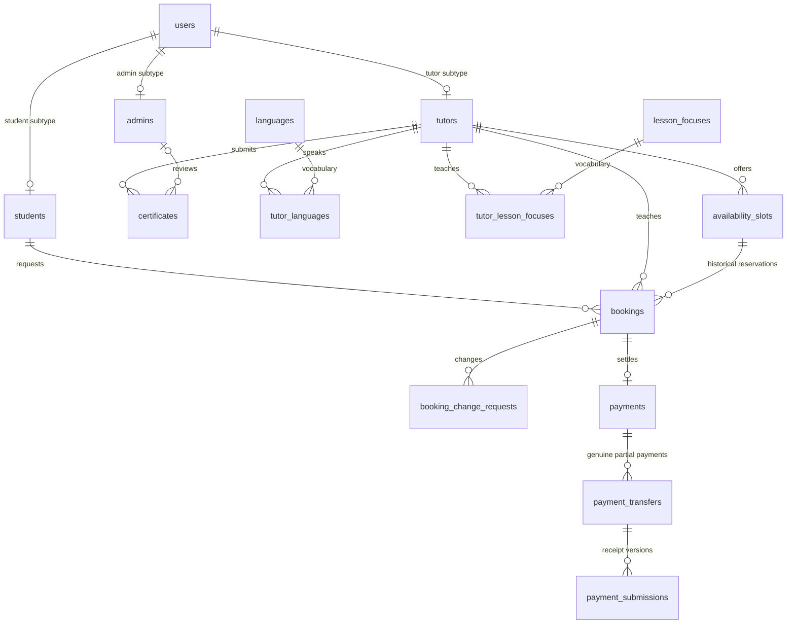
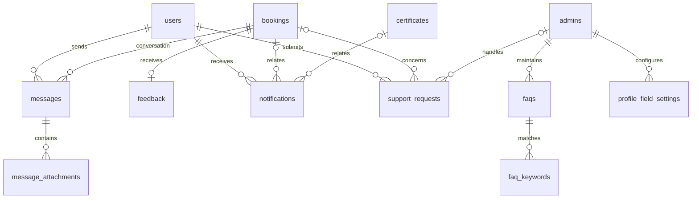

# TutorMeQuran Database Design Proposal

Final Phase 2 design. Status: **approved_business_rules_pending_sql_implementation**.

The owner has resolved Q01–Q15. This document applies those approved business rules and records the final simplified relational design. **No SQL or application implementation is authorized by this document update.** The JSON has the same status.

## 1. Design Goals

Use an understandable PHP/MySQL FYP model that preserves agreements, qualification evidence and payment receipts, prevents duplicate/overlapping bookings, and separates tutor acknowledgement from final admin verification. The final design has **23 tables**. It is not a banking ledger, automated refund system, permissions engine or report-storage system.

Types, key choices, field lengths and transactional protocols below are implementation design choices under the approved rules. Existing demo inconsistencies do not override the owner's decisions.

## Final Simplification Decisions

| Item | Final decision |
| --- | --- |
| Previous table count | 25 |
| Final table count | 23 |
| Removed | `auth_tokens`: password-reset/email delivery and persistent Remember Me are deferred; ordinary PHP sessions and logged-in password changes need no token table. |
| Merged/removed | `payment_reviews` is removed. Tutor acknowledgement and admin evidence-review fields move into `payment_submissions`; the final/current payment decision and reviewer stay in `payments`. No separate review-event log. |
| Payment tables retained | `payments`, `payment_transfers`, `payment_submissions`: booking total, genuine payment identity, and receipt versions. The small middle table prevents a correction from becoming another counted payment. |
| Other tables retained | `booking_change_requests` preserves participant consent and before/after agreements, including marked admin corrections. `support_requests` is a simple authenticated intake record. `faq_keywords` is a small normalized phrase list for rule matching. `profile_field_settings` holds only the existing 7 student/15 tutor toggles. |
| Other reductions | Remove guest support/email-routing fields, generic payment review scopes/events, token lifecycle, and financial reversal logic. Retain relational languages/tags, file attachments, certificate history and ownership keys. |

**Final payment model:** a booking has at most one payment record. Each genuine partial payment has one transfer row. Correcting its receipt creates another submission under the **same transfer**. Only that transfer's latest submission can contribute, and only after tutor acknowledgement and admin acceptance. Admin alone verifies the total payment. Superseded receipt versions retain their files and recorded decisions; this stores receipt history without an event-by-event financial audit log.

## 2. Sources Inspected

- Prior Phase 2 analysis, now updated from the owner's approved Q01–Q15 decisions; the 99 pages were not re-read for this revision.
- Original analysis: `docs/php-conversion-handoff.md` first; `README.md`, `INTERFACE-GUIDE.md`, `docs/availability-and-coordination.md`, `docs/booking-progress-and-actions.md`, `docs/student-navigation-scope.md`, `docs/tutor-workflow.md`.
- Public/account: `register.php`, `login.php`, `tutors.php`, `tutor-detail.php`, `chatbot.php`, `help.php` — fields, filters, account roles and FAQ/support content.
- Student: all 25 PHP pages inspected through their main-content fields/text, particularly dashboard, profile view/edit, booking list/add/view/edit/cancel/coordinate/session/completed, payment upload/view/review/verified/rejected, invoices, feedback add/list, chat, notifications and support request.
- Tutor: all 42 PHP pages inspected through their main-content fields/text, particularly both dashboards, account edit, profile view/edit/setup/visibility, application outcomes, certificate upload/view/replace/verified, all four availability pages, booking list/view/edit/cancel/coordinate/session/completed/rejected, payment QR/confirm/view/issue/received/list, chat, feedback, notifications and support request. Older setup/publishing screens are reference flows, not an additional application process.
- Admin: all 23 PHP pages inspected for fields and statuses: dashboard/profile/settings; student and tutor lists/view/edit; certificate list/review; booking list/view/edit/cancel/closed; payment list/view/confirmed; FAQ list/view/add/edit.
- `report/report-dashboard.php`: comparison, composition, totals, booking trend/distribution and export placeholders on the one page.
- JavaScript: `availability.js`, `lesson-slots.js`, `lesson-selection.js`, `tutor-workflow.js`, `booking-progress.js`, `booking-preview.js`, `duitnow-qr.js`, `registration.js`, `student-workspace.js`, `admin-crud.js`, `action-confirmation.js`, `profile-photo.js`.
- The original proposal PDF/DOCX and complete original ERD source were not present as readable proposal files. Requirement references here are the repository documentation's mapping, not an independent re-reading of the academic proposal. No requirements are inferred from an unidentified screenshot.

### Approved interpretation of the earlier interface

- Availability is 1–24 whole hours and can cross midnight; store full start/end datetimes.
- Basic registration and later teaching-profile completion are separate. Photo/state fields can remain absent until required by profile completion.
- Payment remains after both class-completion confirmations. Inconsistent old example dates are not requirements.
- Confirmed is a display synonym for an accepted booking, not a second booking status.
- Both participants confirm arrangements separately. Both may request schedule/mode changes before the lesson; the other participant accepts. Mark and preserve admin corrections.
- A Public tutor may have zero future available slots. Publication eligibility does not require an available slot.
- Approved upload limits below supersede the demos' older 2 MB receipt/QR limits. Source files remain unchanged in this phase.
- One payment record can contain several genuine partial payments and historical receipt versions. The browser's current date is upload context, not proof of bank transaction date.
- Multiple approved certificates are retained; exactly one can be selected for public display. No ranking, expiry or revocation subsystem.
- Shared names, counts, money and ratings in sample pages are illustrative; derive real totals from records later.

## 3. Proposed Entities

### Conventions and scope

- `ID` below means **INT UNSIGNED**; independent surrogate PKs are **AUTO_INCREMENT**. Junction tables use composite PKs, not extra IDs. `FK` targets are given in each table's key notes. Every FK gets a supporting index unless already covered by a leading PK/UNIQUE/index prefix.
- Use InnoDB and `utf8mb4`. Status columns are proposed `VARCHAR(32)` with an application allowlist and database checks where supported; the lists in section 6 are semantic enums, not SQL ENUM declarations.
- Recommend all persisted `DATETIME` values in **UTC**, converting input/display/calendar comparisons through `Asia/Kuala_Lumpur`. `DATE` values for birth/certificate year/actual bank date retain their calendar meaning. The interface always displays Malaysia time; avoid browser-local time as authority.
- Money uses `DECIMAL(10,2)` in MYR, never floating point. Rates/expected fees must be positive; claimed/recognized transfers cannot be negative. Derive outstanding balance, average rating, next slot, age, profile completeness and dashboard totals rather than storing counters.
- Display references such as ACC-001, ST-001, TU-001, CERT-002, TMQ-1024, PAY-1024 and FB-001 can be formatted from immutable numeric IDs. Do not use sample dates/names or browser-generated slot strings as PKs. A separate UNIQUE public code is unnecessary unless an external reference format is later required.
- Prefer RESTRICT for deletion of users, bookings, certificates, payments and other historical parents. Do not cascade-delete evidence or paid bookings. Admin Delete normally deactivates the account; historical records remain. No automated anonymization/retention process. Cascading pure language/tag association rows is acceptable only when deletion of their parent is otherwise allowed.
- Cross-table role, ownership and state conditions require transactional server checks; ordinary FKs alone do not enforce them. Proposed conditional unique generated keys below supplement, rather than replace, locking. Exact SQL syntax and server compatibility must be checked in the implementation phase.

### 3.1 `users`

Purpose: one credential and shared personal-data record per account. First/last names remain separate to match forms. Students/tutors require IC, phone and address; admins currently only provide name/email/username. Do not duplicate email/password/name in role tables.

| Column | Suggested Type | Key | Nullable | Purpose |
| --- | --- | --- | --- | --- |
| user_id | ID | PK | No | Account identity |
| role | VARCHAR(16) | Index | No | student, tutor or admin; one role per account |
| username | VARCHAR(80) | UNIQUE | No | Current login identifier |
| email | VARCHAR(254) | UNIQUE | No | Globally unique contact address |
| password_hash | VARCHAR(255) | — | No | PHP password hash only |
| first_name | VARCHAR(100) | — | No | Given name |
| last_name | VARCHAR(100) | — | No | Last name |
| ic_number | VARCHAR(20) | — | Yes | Private normalized IC; required for student/tutor registration; deliberately not UNIQUE |
| phone | VARCHAR(32) | — | Yes | Contact string, not a number |
| gender | VARCHAR(24) | — | Yes | male, female, prefer_not_to_say; NULL means not supplied |
| date_of_birth | DATE | — | Yes | Adult eligibility; basic registration data may be completed later |
| personal_state | VARCHAR(40) | — | Yes | Canonical Malaysian state/territory value |
| address | TEXT | — | Yes | Private address/area |
| profile_picture_path | VARCHAR(255) | — | Yes | Controlled image key/path; default avatar when absent |
| account_status | VARCHAR(16) | Index | No | active/inactive, independent of qualification |
| eligibility_confirmed_at | DATETIME | — | Yes | Registration's adult/Malaysia declaration; not proof of verification |
| password_changed_at | DATETIME | — | Yes | Credential/session invalidation support |
| created_at | DATETIME | Index | No | Account creation |
| updated_at | DATETIME | — | No | Latest change |

Keys/indexes: PK(user_id), UNIQUE(username), UNIQUE(email), INDEX(role, account_status). Normalize username/email consistently before uniqueness checks; phone is not unique. No public admin registration or multi-role join table. Each account has exactly one role. A separate account requires its own globally unique username and email; IC is not globally unique.

### 3.2 `students`

Purpose: explicit student subtype for student-only booking FKs and displayed ST references; shared profile data lives in users.

| Column | Suggested Type | Key | Nullable | Purpose |
| --- | --- | --- | --- | --- |
| student_id | ID | PK | No | Student identity |
| user_id | ID | FK, UNIQUE | No | Associated users.user_id |

Keys: PK(student_id), UNIQUE(user_id), FK user_id → users.user_id. Transactionally require users.role=student.

### 3.3 `tutors`

Purpose: tutor teaching profile, visibility and current bank-issued QR. Application outcome is derived from certificate history, not an overloaded tutorStatus column.

| Column | Suggested Type | Key | Nullable | Purpose |
| --- | --- | --- | --- | --- |
| tutor_id | ID | PK | No | Tutor identity |
| user_id | ID | FK, UNIQUE | No | users.user_id with tutor role |
| application_submitted_at | DATETIME | Index | No | Initial application time |
| display_name | VARCHAR(150) | — | Yes | Public title/name, e.g. Ustaz/Ustazah; fallback to personal name |
| displayed_certificate_id | ID | FK (composite) | Yes | One selected approved public qualification; no automatic ranking |
| teaching_state | VARCHAR(40) | Index | Yes | Public teaching state, separate from private residence |
| teaching_area | VARCHAR(255) | — | Yes | Shah Alam etc.; not the booking's exact venue |
| teaching_mode | VARCHAR(16) | — | Yes | online, physical, both |
| hourly_rate | DECIMAL(10,2) | Index | Yes | Unset until teaching profile is prepared |
| bio | TEXT | — | Yes | shortBio from the interface |
| profile_visibility | VARCHAR(16) | Index | No | draft/private/public; initially draft |
| facebook_url | VARCHAR(2048) | — | Yes | Optional existing social field |
| instagram_url | VARCHAR(2048) | — | Yes | Optional existing social field |
| linkedin_url | VARCHAR(2048) | — | Yes | Optional existing social field |
| twitter_url | VARCHAR(2048) | — | Yes | X/Twitter, matching existing twitter input |
| tiktok_url | VARCHAR(2048) | — | Yes | Optional existing social field |
| duitnow_qr_path | VARCHAR(255) | — | Yes | Current controlled bank-issued JPG/PNG file |
| duitnow_qr_updated_at | DATETIME | — | Yes | QR change time |
| updated_at | DATETIME | — | No | Teaching-profile change |

Keys: UNIQUE(user_id); FK user_id → users. Composite FK(displayed_certificate_id, tutor_id) → certificates(certificate_id, tutor_id) prevents another tutor's qualification being selected. Insert tutor with NULL pointer before its certificates. Require an approved certificate when setting the pointer. INDEX(profile_visibility, teaching_state, hourly_rate). Five fixed social columns are simpler than a generic social-network subsystem. No bank account number or automatic QR validation is inferred from the current QR-only form.

### 3.4 `admins`

Purpose: explicit admin subtype and reviewer identity; no separate copy of admin name/email/password.

| Column | Suggested Type | Key | Nullable | Purpose |
| --- | --- | --- | --- | --- |
| admin_id | ID | PK | No | AD reference |
| user_id | ID | FK, UNIQUE | No | users.user_id with admin role |

Keys: UNIQUE(user_id), FK user_id → users.user_id. Provisioning is a later controlled process.

### 3.5 `certificates`

Purpose: immutable evidence/qualification details for each initial, correction or higher-qualification submission. Review outcome may be assigned once; another submission never overwrites the old file/details.

| Column | Suggested Type | Key | Nullable | Purpose |
| --- | --- | --- | --- | --- |
| certificate_id | ID | PK | No | Submission reference |
| tutor_id | ID | FK | No | Owning tutor |
| replaces_certificate_id | ID | FK (self), UNIQUE | Yes | Prior correction attempt; same tutor, no cycles |
| submission_purpose | VARCHAR(32) | — | No | initial, application_correction, higher_qualification |
| certificate_name | VARCHAR(255) | — | No | Name collected at registration/upload |
| certificate_type | VARCHAR(150) | — | Yes | Separate free-text Type on later submission form |
| qualification_level | VARCHAR(32) | — | Yes | ijazah, advanced_ijazah, diploma, bachelor, master, doctorate |
| certificate_year | SMALLINT UNSIGNED | — | No | Award year, validated against current year rather than fixed 2026 |
| origin | VARCHAR(80) | — | Yes | State/territory or outside_malaysia; absent on correction form |
| issuing_authority | VARCHAR(150) | — | Yes | Optional issuer label from reviewed certificate evidence, e.g. MAIK |
| description | TEXT | — | Yes | Certificate description/notes |
| file_path | VARCHAR(255) | — | No | Protected immutable upload key |
| original_filename | VARCHAR(255) | — | No | Display filename only |
| mime_type | VARCHAR(100) | — | No | Server-detected MIME |
| file_size_bytes | INT UNSIGNED | — | No | Validated size |
| status | VARCHAR(32) | Index | No | pending, approved, rejected, superseded |
| submitted_at | DATETIME | Index | No | Server upload/submission time |
| reviewed_by_admin_id | ID | FK | Yes | Reviewing admin; NULL until reviewed |
| reviewed_at | DATETIME | — | Yes | Decision time |
| admin_remark | TEXT | — | Yes | Required on rejection |

Keys: FK tutor_id → tutors; FK replaces_certificate_id → certificates; FK reviewed_by_admin_id → admins; UNIQUE(certificate_id, tutor_id) for the selected qualification FK; UNIQUE(replaces_certificate_id) makes correction chains unbranched; INDEX(status, submitted_at), INDEX(tutor_id, submitted_at). Server checks same tutor, permitted replacement and non-cyclic ancestry. `superseded` is an internal state for a pending attempt replaced before review, not a claim that an earlier approved qualification is invalid.

### 3.6 `languages`

Purpose: reusable language names; avoid comma-separated storage despite the current text input.

| Column | Suggested Type | Key | Nullable | Purpose |
| --- | --- | --- | --- | --- |
| language_id | ID | PK | No | Language identity |
| name | VARCHAR(80) | UNIQUE | No | E.g. Bahasa Melayu, English |

Keys: UNIQUE(name). Map trimmed input tokens to canonical entries in future server processing; no interface redesign now.

### 3.7 `tutor_languages`

Purpose: tutor-to-language many-to-many association.

| Column | Suggested Type | Key | Nullable | Purpose |
| --- | --- | --- | --- | --- |
| tutor_id | ID | PK part, FK | No | tutors.tutor_id |
| language_id | ID | PK part, FK | No | languages.language_id |

Keys: PK(tutor_id, language_id); reverse INDEX(language_id, tutor_id).

### 3.8 `lesson_focuses`

Purpose: canonical lesson-focus tags, initially the displayed Tajweed, Quran Reading, Iqra, Hafazan and Talaqqi.

| Column | Suggested Type | Key | Nullable | Purpose |
| --- | --- | --- | --- | --- |
| focus_id | ID | PK | No | Focus identity |
| name | VARCHAR(100) | UNIQUE | No | Tag label |

Keys: UNIQUE(name). This is a tag vocabulary, not a course/lesson-product catalogue.

### 3.9 `tutor_lesson_focuses`

Purpose: many-to-many tutor expertise/tag association.

| Column | Suggested Type | Key | Nullable | Purpose |
| --- | --- | --- | --- | --- |
| tutor_id | ID | PK part, FK | No | tutors.tutor_id |
| focus_id | ID | PK part, FK | No | lesson_focuses.focus_id |

Keys: PK(tutor_id, focus_id); reverse INDEX(focus_id, tutor_id). Use a small canonical vocabulary; map validated profile selections to these rows rather than storing comma-separated lists.

### 3.10 `availability_slots`

Purpose: one tutor-defined lesson interval. Manual availability and reservation occupancy remain separate concepts.

| Column | Suggested Type | Key | Nullable | Purpose |
| --- | --- | --- | --- | --- |
| slot_id | ID | PK | No | Stable ID, unchanged when an unreferenced slot is edited |
| tutor_id | ID | FK | No | tutors.tutor_id |
| starts_at | DATETIME | UNIQUE part, Index | No | UTC instant from Malaysia date/start |
| ends_at | DATETIME | — | No | Derived from allowed duration, including next day |
| mode | VARCHAR(16) | — | No | online, physical, both |
| availability_status | VARCHAR(16) | — | No | available/unavailable, manual setting only |
| created_at | DATETIME | — | No | Slot creation |
| updated_at | DATETIME | — | No | Last edit |

Keys: FK tutor_id → tutors; UNIQUE(tutor_id, starts_at); UNIQUE(slot_id, tutor_id) for composite booking FK; INDEX(tutor_id, availability_status, starts_at). Duration is derived from ends_at-starts_at, not independently editable duplicated data. A unique start time alone does not prevent overlapping intervals; see section 7. Booked/reserved/past are derived UI labels.

### 3.11 `bookings`

Purpose: lesson agreement, agreed price and progress for one student/tutor/slot. Both timestamps and price are deliberate historical snapshots.

| Column | Suggested Type | Key | Nullable | Purpose |
| --- | --- | --- | --- | --- |
| booking_id | ID | PK | No | TMQ reference |
| student_id | ID | FK | No | students.student_id |
| tutor_id | ID | FK/composite FK | No | Booked tutor; must own slot |
| slot_id | ID | FK (composite) | No | Current agreed availability slot |
| starts_at | DATETIME | Index | No | Agreed start snapshot |
| ends_at | DATETIME | — | No | Agreed end snapshot |
| class_mode | VARCHAR(16) | — | No | online or physical; never both |
| lesson_focus_summary | VARCHAR(255) | — | Yes | Agreed lesson label, e.g. Quran recitation & Tajweed; not a tag FK inferred from notes |
| notes | TEXT | — | Yes | bookingNotes/learning request |
| hourly_rate_snapshot | DECIMAL(10,2) | — | No | Rate at agreement |
| expected_amount | DECIMAL(10,2) | — | No | Rate × booked duration; unchanged by receipt amount |
| status | VARCHAR(32) | Index | No | requested, accepted, rejected, completed, cancelled, closed |
| occupied_slot_id | ID, generated | UNIQUE | Yes | slot_id while requested/accepted/completed/closed; NULL for rejected/cancelled |
| decision_at | DATETIME | — | Yes | Tutor accept/reject timestamp |
| rejection_reason | TEXT | — | Yes | Required if rejected |
| venue_address | VARCHAR(500) | — | Yes | Confirmed physical venue; separate from tutor area |
| meeting_platform | VARCHAR(80) | — | Yes | External platform label |
| meeting_url | VARCHAR(2048) | — | Yes | Agreed private meeting link |
| student_arranged_at | DATETIME | — | Yes | Student confirmation of the current agreed arrangement |
| tutor_arranged_at | DATETIME | — | Yes | Tutor confirmation of the current agreed arrangement |
| student_completed_at | DATETIME | — | Yes | Student's own class confirmation |
| tutor_completed_at | DATETIME | — | Yes | Tutor's own class confirmation |
| cancelled_by_user_id | ID | FK | Yes | Actual student/tutor/admin actor |
| cancelled_at | DATETIME | — | Yes | Server cancellation time |
| cancellation_reason | TEXT | — | Yes | Required for cancellation |
| cancellation_timing | VARCHAR(24) | — | Yes | early/same_day; after_lesson_date only for a manual admin exception |
| closed_at | DATETIME | — | Yes | Final payment verification/closure time |
| created_at | DATETIME | Index | No | bookingTimestamp |
| agreement_version | INT UNSIGNED | — | No | Increment on material agreement change; reject stale confirmations/requests |
| updated_at | DATETIME | — | No | Latest transition |

Keys: FK student_id → students; FK tutor_id → tutors; composite FK(slot_id, tutor_id) → availability_slots(slot_id, tutor_id); FK cancelled_by_user_id → users. UNIQUE(occupied_slot_id); INDEX(student_id, status, starts_at), INDEX(tutor_id, status, starts_at), INDEX(created_at). Same-slot rejected/cancelled history can coexist with one later occupying booking. Completed/closed remain occupying for historical integrity; they do not free a past lesson for another sale. Generated key is not client-supplied and is not itself a foreign key.

### 3.12 `booking_change_requests`

Purpose: preserve before/after agreement and the other participant's decision for schedule, mode or arrangement changes. Admin corrections use the same record, explicitly marked, so they cannot silently overwrite history.

| Column | Suggested Type | Key | Nullable | Purpose |
| --- | --- | --- | --- | --- |
| change_request_id | ID | PK | No | Change reference |
| booking_id | ID | FK | No | bookings.booking_id |
| requested_by_user_id | ID | FK | No | Requesting student/tutor or correcting admin |
| is_admin_correction | TINYINT(1) | — | No | Default 0; only admin may set 1 |
| base_agreement_version | INT UNSIGNED | — | No | Booking version the request proposes to change |
| original_slot_id | ID | FK | No | Existing slot; interval remains historical |
| requested_slot_id | ID | FK | No | Target slot; same slot for mode/venue-only change |
| original_mode | VARCHAR(16) | — | No | Agreed online/physical mode |
| requested_mode | VARCHAR(16) | — | No | Proposed online/physical mode |
| original_venue_address | VARCHAR(500) | — | Yes | Prior physical agreement |
| requested_venue_address | VARCHAR(500) | — | Yes | Proposed physical venue, if known |
| original_meeting_platform | VARCHAR(80) | — | Yes | Prior online platform |
| requested_meeting_platform | VARCHAR(80) | — | Yes | Proposed online platform |
| original_meeting_url | VARCHAR(2048) | — | Yes | Prior private meeting link |
| requested_meeting_url | VARCHAR(2048) | — | Yes | Proposed private meeting link |
| original_expected_amount | DECIMAL(10,2) | — | No | Previous agreement total |
| proposed_expected_amount | DECIMAL(10,2) | — | No | Original hourly rate × target slot duration |
| reason | TEXT | — | No | Participant request/admin correction reason |
| status | VARCHAR(32) | Index | No | pending, accepted, rejected, withdrawn |
| pending_booking_id | ID, generated | UNIQUE | Yes | booking_id only while pending |
| responded_by_user_id | ID | FK | Yes | Other participant, or authorized admin correction actor |
| response_note | TEXT | — | Yes | Rejection explanation or admin correction note |
| requested_at | DATETIME | — | No | Request/correction time |
| responded_at | DATETIME | — | Yes | Decision/withdrawal time |

Keys: FKs booking_id → bookings; requested_by_user_id/responded_by_user_id → users; original_slot_id/requested_slot_id → availability_slots; UNIQUE(pending_booking_id); INDEX(booking_id, requested_at). Slots must belong to the booking tutor. One pending request per booking. Detect what changed by comparing values; no separate change-type enum is needed. Original hourly_rate_snapshot is immutable in bookings, including when duration changes.

Pending requests hold neither the target slot nor the student's proposed time. At acceptance, recheck the booking version, both participants' authority, future time, supported mode, slot occupancy and student overlap. Admin corrections preserve the same before/after data with admin actor/reason; they are not participant consent. Accepted material changes reset both arrangement timestamps. Do not delete these records or mutate referenced slot intervals. Normal closed/verified bookings remain read-only.

### 3.13 `payments`

Purpose: one payment summary per completed booking, with the **final admin decision** separate from individual tutor acknowledgements.

| Column | Suggested Type | Key | Nullable | Purpose |
| --- | --- | --- | --- | --- |
| payment_id | ID | PK | No | PAY reference |
| booking_id | ID | FK, UNIQUE | No | bookings.booking_id |
| status | VARCHAR(32) | Index | No | pending, underpaid, rejected, reupload_required, verified |
| evidence_revision | INT UNSIGNED | — | No | Changes with submissions/reviews; prevents stale final approval |
| recipient_name_snapshot | VARCHAR(200) | — | No | Tutor name displayed with payment instructions |
| qr_path_snapshot | VARCHAR(255) | — | Yes | Immutable QR version used for instructions |
| admin_remark | TEXT | — | Yes | Current aggregate decision/manual issue note |
| reviewed_by_admin_id | ID | FK | Yes | Latest aggregate reviewer |
| reviewed_at | DATETIME | — | Yes | Latest aggregate review |
| verified_by_admin_id | ID | FK | Yes | Final approving admin |
| verified_at | DATETIME | — | Yes | Final approval time |
| created_at | DATETIME | Index | No | Create once both completion timestamps exist |
| updated_at | DATETIME | — | No | Latest payment-summary change |

Keys: UNIQUE(booking_id); FK booking_id → bookings; reviewed_by_admin_id/verified_by_admin_id → admins; INDEX(status, created_at), INDEX(verified_at). Expected amount comes from bookings.expected_amount, not student input. Do not store a second independent expected/paid/outstanding balance. Before completion, invoice screens derive the not-yet-due fee from bookings.

Only admin can set Verified, alongside booking closure in one transaction. On new evidence/tutor review, status becomes pending and current aggregate reviewer/time/remark are cleared; evidence-specific decisions on old submissions remain. A verified payment accepts no normal edits. This stores the current/final summary, not a history of every admin button press.

### 3.14 `payment_transfers`

Purpose: a small identity/grouping record for each **genuine payment** made outside the application. It is not a bank ledger, wallet or payout record.

| Column | Suggested Type | Key | Nullable | Purpose |
| --- | --- | --- | --- | --- |
| transfer_id | ID | PK | No | Stable identity of one genuine partial/full payment |
| payment_id | ID | FK | No | payments.payment_id |
| bank_reference | VARCHAR(150) | Index | Yes | Optional reference from evidence; assists manual duplicate detection |
| created_at | DATETIME | — | No | First claim of this payment |

Keys: FK payment_id → payments; INDEX(payment_id, created_at), INDEX(bank_reference). No global bank-reference uniqueness assumption. A new RM36 top-up gets a new row; a new image correcting the RM4 receipt stays under the original row. No balance, bank account or money-movement entries are stored here.

### 3.15 `payment_submissions`

Purpose: receipt versions plus their tutor and admin decisions. This absorbs the old payment_reviews table. Uploaded evidence/amounts are immutable; review fields describe the current decision on that version. Once replaced, the version and its decisions are frozen.

| Column | Suggested Type | Key | Nullable | Purpose |
| --- | --- | --- | --- | --- |
| submission_id | ID | PK | No | Receipt version |
| transfer_id | ID | FK | No | payment_transfers.transfer_id |
| attempt_number | SMALLINT UNSIGNED | UNIQUE part | No | Monotonic version allocated while locking payment |
| uploaded_by_user_id | ID | FK | No | Booking's student user |
| amount_paid | DECIMAL(10,2) | — | No | Claimed amount for this genuine payment, not cumulative paid-to-date |
| transfer_date | DATE | — | Yes | Optional bank date from evidence; never inferred from upload date |
| payment_note | TEXT | — | Yes | Student receipt/correction note |
| file_path | VARCHAR(255) | — | No | Protected immutable upload key |
| original_filename | VARCHAR(255) | — | No | Display/download filename |
| mime_type | VARCHAR(100) | — | No | Server-detected PDF/JPEG/PNG |
| file_size_bytes | INT UNSIGNED | — | No | Validated maximum 5 MB |
| file_sha256 | CHAR(64) | Index | No | Duplicate-evidence warning, not proof of banking uniqueness |
| tutor_status | VARCHAR(16) | — | No | awaiting, received, issue; initially awaiting |
| tutor_issue_type | VARCHAR(40) | — | Yes | not_received, amount_mismatch, reference_mismatch |
| tutor_remark | TEXT | — | Yes | Explanation/issue resolution |
| tutor_reviewed_at | DATETIME | — | Yes | Booked tutor's acknowledgement/issue time |
| admin_status | VARCHAR(24) | — | No | pending, valid, rejected, reupload_required; initially pending |
| reviewed_by_admin_id | ID | FK | Yes | Evidence reviewer |
| admin_reviewed_at | DATETIME | — | Yes | Evidence decision time |
| admin_remark | TEXT | — | Yes | Required rejection/reupload reason or review note |
| uploaded_at | DATETIME | Index | No | Server upload time |

Keys: FK transfer_id → payment_transfers; uploaded_by_user_id → users; reviewed_by_admin_id → admins; UNIQUE(transfer_id, attempt_number); INDEX(uploaded_at), INDEX(file_sha256). The booked tutor is derived through transfer→payment→booking, so no redundant freely selectable tutor actor column. Authorize that actor before writing tutor_status.

The **highest attempt_number per transfer** is the only current receipt. It contributes amount_paid only when tutor_status=received AND admin_status=valid. Superseded versions never contribute, regardless of their old decisions. A valid receipt is not a Verified payment: Admin must still verify the complete booking total.

An issue resolution can update the current version's review fields; this FYP does not retain every intermediate review event. New evidence or a corrected amount must create a new version instead of overwriting the old upload. A tutor decision change invalidates the current version's admin review (pending, reviewer/time cleared); all changes increment payments.evidence_revision. Replacement starts both reviews again for that transfer only. Older versions/files remain for review, including prior rejection/reupload remarks.

### 3.16 `messages`

Purpose: one booking conversation, including text and confirmed location shares. No conversation-room, WebSocket or participant-membership tables are needed for two booked parties.

| Column | Suggested Type | Key | Nullable | Purpose |
| --- | --- | --- | --- | --- |
| message_id | ID | PK | No | Message identity |
| booking_id | ID | FK | No | bookings.booking_id |
| sender_user_id | ID | FK | No | Student or tutor participant |
| message_type | VARCHAR(16) | — | No | text, attachment, location |
| body | TEXT | — | Yes | Up to current 2,000-character compose limit |
| location_label | VARCHAR(500) | — | Yes | Confirmed venue/address text |
| latitude | DECIMAL(9,6) | — | Yes | Optional shared coordinate |
| longitude | DECIMAL(10,6) | — | Yes | Optional shared coordinate |
| sent_at | DATETIME | — | No | Server timestamp |
| read_at | DATETIME | — | Yes | When the other participant read it |

Keys: FK booking_id → bookings; FK sender_user_id → users; INDEX(booking_id, message_id). Require text, an attachment, or a valid location according to type. Coordinates are a nullable pair with latitude ±90/longitude ±180; a venue address needs no coordinates. Construct Maps URLs from validated values. Sharing a message/location does not itself update the confirmed booking venue or mode. One read_at is sufficient only for the two-party chat; admin read access must not mark it read for a participant.

### 3.17 `message_attachments`

Purpose: store the actual document/photo/video/camera attachments offered by the coordinate pages, not only plain text chat.

| Column | Suggested Type | Key | Nullable | Purpose |
| --- | --- | --- | --- | --- |
| attachment_id | ID | PK | No | File identity |
| message_id | ID | FK | No | messages.message_id |
| file_path | VARCHAR(255) | — | No | Protected upload key |
| original_filename | VARCHAR(255) | — | No | Display filename |
| mime_type | VARCHAR(100) | — | No | Detected media type |
| file_size_bytes | INT UNSIGNED | — | No | Validated maximum 10 MB |

Keys: FK message_id → messages; INDEX(message_id). Message sender/time provide uploader/time without duplication. Multiple files can share one message; current preview appends separate cards, which the design also supports.

### 3.18 `feedback`

Purpose: one student review for one completed lesson; receiving tutor and author derive from the booking.

| Column | Suggested Type | Key | Nullable | Purpose |
| --- | --- | --- | --- | --- |
| feedback_id | ID | PK | No | FB reference |
| booking_id | ID | FK, UNIQUE | No | bookings.booking_id; prevents duplicate feedback |
| rating | TINYINT UNSIGNED | — | No | Integer 1–5 |
| comment | TEXT | — | Yes | Student comments |
| created_at | DATETIME | Index | No | feedbackDate |

Keys: UNIQUE(booking_id), FK booking_id → bookings. No independently editable student_id/tutor_id that could disagree with the booking. Eligibility is both class confirmations; payment need not be Verified. Require integer rating 1–5. No tutor-authored reviews or invented moderation states.

### 3.19 `notifications`

Purpose: persist the account-specific booking, payment and qualification updates displayed in menus/pages.

| Column | Suggested Type | Key | Nullable | Purpose |
| --- | --- | --- | --- | --- |
| notification_id | ID | PK | No | Update identity |
| recipient_user_id | ID | FK | No | users.user_id |
| type | VARCHAR(50) | — | No | Allowlisted event name |
| title | VARCHAR(200) | — | No | Short heading |
| message | TEXT | — | No | Snapshot of user-facing event text |
| booking_id | ID | FK | Yes | Related booking |
| certificate_id | ID | FK | Yes | Related qualification event |
| created_at | DATETIME | — | No | Event time |
| read_at | DATETIME | — | Yes | NULL means unread |

Keys: FKs recipient_user_id → users, booking_id → bookings, certificate_id → certificates; INDEX(recipient_user_id, read_at, created_at). Payment notifications link through booking→payment. At most one related FK; account notices may have neither. Generate links using allowlisted type and authorized records, not arbitrary stored URLs. Create notices with the domain transaction; no email/push delivery assumed.

### 3.20 `faqs`

Purpose: admin-managed answers for the public and account FAQ/help interfaces and a rule-based chatbot.

| Column | Suggested Type | Key | Nullable | Purpose |
| --- | --- | --- | --- | --- |
| faq_id | ID | PK | No | FAQ identity |
| question | VARCHAR(500) | — | No | Current Question / Keyword field |
| answer | TEXT | — | No | Managed answer |
| status | VARCHAR(16) | Index | No | active/inactive |
| created_by_admin_id | ID | FK | No | Initial author |
| updated_by_admin_id | ID | FK | No | Latest editor |
| created_at | DATETIME | — | No | Creation |
| updated_at | DATETIME | — | No | Last edit |

Keys: admin IDs → admins; INDEX(status). Question uniqueness is unnecessary. No chatbot conversation storage, AI API or learned-response table.

### 3.21 `faq_keywords`

Purpose: optional normalized matching phrases per FAQ without putting a list of phrases into one field.

| Column | Suggested Type | Key | Nullable | Purpose |
| --- | --- | --- | --- | --- |
| faq_id | ID | PK part, FK | No | faqs.faq_id |
| keyword | VARCHAR(100) | PK part | No | Normalized token/phrase |

Keys: PK(faq_id, keyword), FK faq_id → faqs; INDEX(keyword, faq_id). Several FAQs may share a keyword; rank matches deterministically. The existing single Question / Keyword input can supply the initial phrase; a separate keyword editor is not assumed. Inactive FAQs never answer queries.

### 3.22 `profile_field_settings`

Purpose: persist the exact editable-field toggle groups, without introducing role-permission hierarchies.

| Column | Suggested Type | Key | Nullable | Purpose |
| --- | --- | --- | --- | --- |
| role | VARCHAR(16) | PK part | No | student or tutor |
| field_key | VARCHAR(40) | PK part | No | Server-defined group, not a submitted SQL column name |
| is_editable | TINYINT(1) | — | No | 0/1 |
| updated_by_admin_id | ID | FK | No | admins.admin_id |
| updated_at | DATETIME | — | No | Change time |

Keys: PK(role, field_key), FK updated_by_admin_id → admins. Current student keys: profile_picture, full_name, phone, address, gender, date_of_birth, password (7). Tutor keys: profile_picture, full_name, phone, gender, date_of_birth, address, teaching_mode, teaching_state, teaching_location, languages, lesson_focus, hourly_rate, bio, social_networks, password (15). `full_name` controls both name columns; social_networks controls five URL columns. Approved qualification/certificate/identity-verification fields are permanently excluded. No new toggles for email, personal state, display name or visibility. Those fields follow their normal validated profile workflows; address covers the private address/state group. Initialize the existing 22 keys as editable, as shown in the interface; treat a missing configured key as disabled until repaired. Password changes remain subject to the existing password toggle and current-password verification.

### 3.23 `support_requests`

Purpose: simple authenticated student/tutor support intake. Admin may handle requests when its management interface is implemented. No guest account resolution, email delivery, refund automation or ticket-thread subsystem.

| Column | Suggested Type | Key | Nullable | Purpose |
| --- | --- | --- | --- | --- |
| request_id | ID | PK | No | Support reference |
| requester_user_id | ID | FK | No | Authenticated student/tutor |
| category | VARCHAR(24) | — | No | billing, attendance, other |
| booking_id | ID | FK | Yes | Optional booking belonging to requester |
| description | TEXT | — | No | Request details |
| photo_path | VARCHAR(255) | — | Yes | Optional protected JPG/PNG, maximum 5 MB |
| status | VARCHAR(24) | Index | No | open/resolved |
| handled_by_admin_id | ID | FK | Yes | Admin handler, when management is implemented |
| resolution_note | TEXT | — | Yes | Manual handling note |
| created_at | DATETIME | — | No | Intake time |
| resolved_at | DATETIME | — | Yes | Resolution time |

Keys: requester_user_id → users; booking_id → bookings; handled_by_admin_id → admins; INDEX(status, created_at), INDEX(requester_user_id, created_at). Require student/tutor role and booking ownership. Contact email derives from users. Public reference strings never grant access or create a private-booking lookup endpoint; guest support persistence is outside this initial schema. Admin support access does not grant access to the booking's private conversation.

## 4. Relationships

- Users 1 → 0..1 students, 0..1 tutors, 0..1 admins. Exactly one matching subtype must exist per account; create it transactionally with its single role.
- Tutor 1 → many certificates, potentially several approved. The nullable displayed_certificate_id selects at most one approved certificate belonging to that tutor; Public requires one. Admins review certificates.
- Tutors ↔ languages and tutors ↔ lesson_focuses through their junction tables.
- Tutor 1 → many availability_slots. Student/tutor each 1 → many bookings. A slot has many historical bookings but at most one occupying booking. The composite booking FK enforces slot/tutor consistency.
- Booking 1 → many booking_change_requests, at most one pending. Both slot references belong to the booked tutor. Admin corrections are explicitly marked records, not an additional history table.
- Booking 1 → 0..1 payments. Payment 1 → many payment_transfers. Transfer 1 → many payment_submissions. Each submission stores its own tutor acknowledgement and admin evidence decision; only payments carries final verification.
- Booking 1 → many messages; message 1 → many message_attachments. User 1 → many sent messages. No unrestricted admin-chat relationship.
- Booking 1 → 0..1 feedback. Student/tutor identities derive from booking, preventing a review being assigned to another tutor.
- Users receive notifications and submit support_requests; notifications optionally reference a booking or certificate; support optionally references an owned booking and admin handler.
- FAQ 1 → many faq_keywords. Admins author FAQs and manage the fixed profile-field settings.

## 5. ERD

Two views describe the same 23 tables. Secondary actor/self-reference FKs are specified in section 3.

## 6. Status Definitions

These are semantic allowlists for VARCHAR columns, not SQL declarations. Derived values are not extra columns.

| Domain | Values | Meaning |
| --- | --- | --- |
| users.role | student, tutor, admin | Exactly one role, not a multi-role membership. |
| users.account_status | active, inactive | Account access; separate from certificate approval. Inactive preserves history. |
| Tutor application (derived) | pending, approved, rejected | If any approved certificate exists, approved. Otherwise latest initial/correction attempt determines pending/rejected. |
| certificates.status | pending, approved, rejected, superseded | Unreviewed, admin-approved, rejected with reason, or pending attempt replaced before review. Earlier approvals remain approved. |
| certificates.submission_purpose | initial, application_correction, higher_qualification | Why the submission was created. |
| certificates.qualification_level | ijazah, advanced_ijazah, diploma, bachelor, master, doctorate | Nullable descriptive level, never an automatic ranking. |
| tutors.profile_visibility | draft, private, public | Preparing, deliberately unlisted, or eligible published profile. Public can have no future slots. |
| tutors.teaching_mode / availability_slots.mode | online, physical, both | Tutor/slot capability. |
| bookings.class_mode / change original_mode / requested_mode | online, physical | One actual lesson mode, never both. |
| availability_slots.availability_status | available, unavailable | Manual offer/block; occupancy and past labels are derived. |
| Availability occupancy (derived) | reserved, booked, past | Requested booking; accepted/completed/closed booking; elapsed interval respectively. |
| booking_change_requests.status | pending, accepted, rejected, withdrawn | Unapplied request, applied agreement, refused proposal, or request ended without application. |
| bookings.cancellation_timing | early, same_day, after_lesson_date | Before Malaysia start date; on that date; exceptional manual admin cancellation after that date. The third value only records an exception, not a new automated cancellation workflow. |
| payments.status | pending, underpaid, rejected, reupload_required, verified | Current payment-summary/admin decision; meanings below. |
| payment_submissions.tutor_status | awaiting, received, issue | No acknowledgement; tutor checked receipt/funds for this amount; mismatch needing attention. |
| payment_submissions.tutor_issue_type | not_received, amount_mismatch, reference_mismatch | Nullable issue reason. |
| payment_submissions.admin_status | pending, valid, rejected, reupload_required | Unreviewed; acceptable current receipt; excluded invalid/duplicate claim; needs correction. Valid is NOT final payment verification. |
| messages.message_type | text, attachment, location | Message content type. |
| faqs.status | active, inactive | Eligible/ineligible for FAQ matching. |
| support_requests.category | billing, attendance, other | Existing request categories. |
| support_requests.status | open, resolved | Simple request intake/handling. |
| Read state (derived) | read_at NULL/non-NULL | Unread/read; no duplicate flag. |

### Booking lifecycle and UI progress

| Stored booking status | Meaning / normal transition |
| --- | --- |
| requested | Student reserved a slot, awaiting tutor decision → accepted/rejected/cancelled. |
| accepted | Tutor accepted; arrangement and lesson occur within this state → completed after both completions, or allowed cancellation. |
| rejected | Tutor declined with a reason; releases slot, no payment due. |
| completed | Both parties confirmed the class; payment can be uploaded, and feedback is available → closed after admin final verification. |
| cancelled | Actor/reason/time/timing retained; reservation released; no fee/refund automatically applied. |
| closed | Lesson completed and admin verified payment; normal record is read-only. |

The normal terminal states are rejected, cancelled and closed. Exceptional cases go to manual Admin/support, not an automatic reopening/reversal workflow.

| UI step or legacy JS label | Derived meaning, not an additional booking status |
| --- | --- |
| Booking / requested | requested |
| Arrange / accepted | accepted with one or both arrangement confirmations missing |
| Class / arranged / session / Confirmed | accepted, both arrangement confirmations recorded; each confirms class completion independently |
| Payment / completed / receipt / received / issue | completed with the appropriate current receipt/tutor/admin evidence state |
| Verified / Done | closed AND payments.status=verified |
| Cancelled by Student/Tutor; Late Cancellation | cancelled plus actor and timing; preserve actor even for same-day cancellation |
| Pending bookings tab | Upcoming/in-progress grouping, not a separate database state |

### Payment-summary meanings

- **pending:** no final/current negative admin decision; awaiting receipt, tutor acknowledgement or admin review. New/corrected evidence returns a nonfinal payment to pending.
- **underpaid:** Admin reviewed the evidence and the valid total is below expected. Receipt entry/acknowledgement alone is not proof of settlement.
- **rejected:** Admin rejected the relevant payment evidence/claim with a reason; the lesson itself is not thereby rejected.
- **reupload_required:** evidence must be corrected; this does not request another money transfer.
- **verified:** Admin alone approved final payment after checking the current valid total and completion requirements.

A rejected current submission contributes zero. It may remain as an excluded invalid/duplicate claim while other genuine payments settle the fee. A pending or reupload-required current submission must be resolved before final approval. Tutor received and admin receipt valid are deliberately distinct from payment Verified.

## 7. Business Rules

### Accounts, qualifications and public profiles

1. Username and normalized email are globally UNIQUE. IC is not globally UNIQUE. Create users and exactly one matching subtype atomically; trust the stored role, not the login form's role selector. Manually provision admins; no public admin registration.
2. Registration collects the existing basic personal/account information. Profile picture/teaching information can be completed later. Personal details remain editable according to the existing field allowlist and normal validation; do not duplicate names/email/password across subtype tables.
3. Only admin approves certificates. A tutor can retain many approved submissions. Select exactly one approved certificate for the public qualification; selection must belong to that tutor, with no automatic level ranking. A new/rejected higher submission never removes a prior approval. No automatic expiry/revocation: manual account deactivation handles access restrictions.
4. Pending/rejected applicants retain personal-account access but cannot publish or use verified teaching tools. Approved teaching profile begins Draft. Publishing requires an active account, selected approved certificate, profile image, teaching state/area, supported mode, positive rate, bio and required teaching data, including nonempty language/focus associations. Do not require an available future slot to remain Public. A Public profile with no slots shows no currently available booking slots.
5. Keep personal residence distinct from public teaching area. Store languages/focus tags relationally and five fixed social URLs as columns. A small canonical state/territory allowlist needs no new table. Approved qualification/file/verification fields never become freely editable through profile settings.
6. Keep the existing 7 student/15 tutor setting groups only. No new settings engine. Logged-in password changes verify the current password and update the hash; email-reset delivery and persistent Remember Me are deferred. Deactivation prevents new authenticated actions/bookings without deleting historical records; Admin/support manually handles affected existing lessons.

### Availability, slot uniqueness and student overlap

7. Validate the full start instant is not in the past. Inputs use Malaysia time with whole-hour start and 1–24-hour duration; derive ends_at server-side and store UTC. Ends_at must be later chronologically. Overnight/24-hour lessons are supported; no independent client-controlled end/price.
8. For one tutor, availability intervals must not overlap, including blocked intervals; adjacent intervals are allowed. A different-start UNIQUE constraint cannot detect interval overlap. Once a slot is referenced by a booking/change request, its tutor/start/end remain immutable and the slot is not deleted. Rescheduling selects another offered valid slot, potentially of a different duration; it does not rewrite the old slot's interval.
9. A new requested booking immediately occupies its slot. UNIQUE(occupied_slot_id) additionally enforces one occupying booking: the generated value is slot_id for requested/accepted/completed/closed and NULL for rejected/cancelled. Rejected/cancelled historical rows can coexist with a future rebooking. Completed/closed never free a past lesson for sale.
10. A student must not hold overlapping active bookings, **including across different tutors**. Active blockers are requested and accepted. Compare full intervals: a conflict exists when each interval starts before the other ends. Adjacent intervals are allowed. Normal future-time validation prevents historical completed/closed lessons being rebooked.
11. **Required transaction/lock order for later implementation:** lock the student row first, then tutor row, then relevant slot rows in ascending slot_id, then booking/change records. For any multi-record operation lock all students in ascending ID before all tutors in ascending ID. Slot-only edits lock the tutor and slots and must never acquire a student lock afterward. Payment processing locks booking then payment; it must not later acquire participant/slot locks.
12. Under those locks, re-read the current booking/slot, check future interval, occupancy and tutor mode, and check the student's active overlapping bookings. Exclude the same booking when checking its own reschedule. All creation, cancellation, reschedule acceptance and admin schedule corrections must follow the same participant-lock protocol. Holding a student row serializes simultaneous attempts with different tutors even when no conflicting booking row exists yet. Holding the tutor row serializes slot-overlap checks. A plain unlocked check-then-insert is insufficient.
13. Conditional unique generated keys supplement locking; they do not enforce time-range/student-overlap constraints. The earlier technical references remain relevant: [MySQL generated-column indexes](https://dev.mysql.com/doc/refman/8.0/en/create-table-secondary-indexes.html), [MariaDB generated columns](https://mariadb.com/docs/server/reference/sql-statements/data-definition/create/generated-columns). Exact DDL/version testing belongs to the later SQL phase, not a new unresolved business question.
14. No automatic pending-booking expiry. Proposed rescheduling holds no target slot and creates no second active student reservation. The original booking remains the effective reservation until acceptance succeeds.

### Changes, arrangements, completion and cancellation

15. Either participant may propose a schedule and/or mode change before the lesson; the **other participant** accepts/rejects. Both original and proposed start must still be in the future on normal acceptance. Do not reset the tutor's original acceptance merely because a mutually accepted reschedule occurred.
16. Store old/new slot, mode, amount and meeting details before application. Recompute proposed_expected_amount using **the original bookings.hourly_rate_snapshot × target duration**. The rate snapshot never changes because the tutor later changes rates. Same duration/mode-only changes leave expected amount unchanged. No temporary hold; acceptance can fail if someone else reserved the target or the student acquired a conflicting lesson meanwhile.
17. Both Physical→Online and Online→Physical are supported with counterpart consent and tutor capability. New bookings use slot capability. For a consented mode-only change, the tutor must support the requested mode; do not rewrite shared historical slot.mode to represent that private agreement. For a schedule change also validate the target slot's mode capability. A single booking always has only one effective mode.
18. Physical venue must be agreed before either party confirms the physical arrangement; online meeting details are similarly stored as the agreed arrangement. Require **both** student_arranged_at and tutor_arranged_at before arrangement is complete. Confirmations apply to the submitted agreement_version; reject stale confirmation forms.
19. Applying a material change increments agreement_version and clears **both** arrangement timestamps. Location/link changes are material too and use the same before/after record and counterpart consent; selecting a map/message does not silently change the agreement. Inapplicable old meeting/venue fields are cleared in the effective booking but remain in change history.
20. Admin may make necessary booking corrections using a marked admin-correction record with actor, reason and before/after values. Same slot/tutor/student protections and original-rate calculation still apply. Withdraw an obsolete pending participant request. Do not falsely record student/tutor acceptance for an admin correction. Normal completed/closed records and verified payments are not reopened by this feature; exceptional disputes are handled manually through support.
21. Each participant confirms only their own class completion after the lesson took place. Normal completion requires accepted booking, both arrangements and scheduled end reached. Both completion timestamps move booking to completed and make payment and feedback available. One participant cannot confirm for the other. No-shows/disputed completion go to manual support.
22. Early cancellation is before the lesson's **Malaysia start calendar date**; same-date cancellation is same_day/Late Cancellation, even earlier that day. Store actual cancelling user, reason and server timestamp; release occupancy and withdraw pending requests transactionally. Normal self-service cancellation is for requested/accepted lessons before start; after-start or retrospective cases are manually handled by Admin. For a manual cancellation after the start calendar date, after_lesson_date records that exception without mislabelling it early.
23. No automatic cancellation fee, penalty or refund. Deactivation, no-show, disputed completion, overpayment and mistaken verification go to Admin/support. Closed/verified records remain read-only through normal workflows; no reversal-accounting subsystem.

### Three-table manual payment workflow

24. After both class confirmations, create exactly one payments row per booking, initially pending. The expected amount remains bookings.expected_amount. Before then, an invoice may display the booking fee as not due; no payment row is needed just to render it.
25. Student pays outside the application using DuitNow. A new genuine payment creates one payment_transfers row and its first payment_submissions row. The student enters the amount for **that payment**, not the running total. Optional bank reference/date may be recorded from evidence; uploaded_at is always the server timestamp and never falsely labelled as bank transfer date.
26. The later workflow must explicitly distinguish **Add another payment receipt** from **Correct/replace this receipt**. Correction references an existing owned transfer_id and creates the next attempt_number under it. The backend, not a hidden amount/filename heuristic, controls this association. Changing amount/evidence creates a new version, never edits an older upload.
27. Determine the highest attempt_number per transfer first. A transfer contributes exactly that one version's amount_paid only when tutor_status=received **and** admin_status=valid. Sum those amounts across the booking's transfers. Outstanding amount is max(expected amount minus valid total, 0); a total above expected is separately flagged for manual Admin/support, never hidden by this zero floor or called extra revenue.
28. Tutor checks the bank against each current receipt/entered amount and marks received or issue. The tutor may acknowledge a genuine RM4 partial payment; acknowledgement does not require the whole RM40 fee. Admin reviews the same current version and marks it valid/rejected/reupload_required. If the entered amount is wrong, require a corrected version so acknowledgement applies to the corrected amount. No auto-verification by QR parsing, upload success or sample JS flags.
29. A correction resets only that transfer's current acknowledgement/admin review; older receipts and decisions remain stored but no longer count. Other transfers' valid current receipts remain valid. Updating the current tutor decision invalidates that version's admin decision until rechecked. All evidence/review changes lock the payment, increment evidence_revision and return a nonfinal payment to pending for review. Superseded versions are read-only.
30. Admin sets the aggregate underpaid when reviewed valid funds fall short; rejected/reupload_required when relevant evidence needs that decision; otherwise pending while checks remain. For final Verified, lock booking and payment, compare the submitted evidence_revision, recheck both completions, and recalculate the current valid total. All current versions must be resolved as valid or rejected; valid versions require tutor received. Pending/reupload-required evidence blocks final verification. Explicitly rejected invalid/duplicate claims are excluded, not counted and not mistaken for additional debt.
31. The normal final verification path requires valid total **equal to** the expected amount. Admin alone writes payments.status=verified, final reviewer/time and bookings.status=closed/closed_at atomically. If an overpayment is present, keep a manual-review note and route to Admin/support; this design does not automate refunds or reverse verified records. Tutor received, receipt valid and payment Verified remain three distinct facts.
32. Preserve every receipt version and its recorded decisions. The current version may have its latest review fields updated until replaced; the schema deliberately does not record every intermediate review click. Payment summary stores the latest/final admin decision. No extra review-event table is needed for the approved FYP requirements.
33. File hashes and optional bank references help flag duplicate receipts. They are not proof of distinct bank transfers. Admin must reject an accidentally duplicated payment claim; a reupload through the correction action **cannot** add another counted transfer. After Verified, normal uploads/reviews/amount changes are blocked.

### Feedback, chat, notifications, FAQ and support

34. One feedback per booking enforced by UNIQUE(booking_id). Only its student may submit, with integer rating 1–5, once both completion timestamps exist. **Payment need not be Verified.** Receiving tutor and author derive from the booking.
35. Booking chat is private to its student and tutor. Enforce participant ownership for send/read/attachment download; one read_at is enough for two participants. Store confirmed location shares and safe attachments without a WebSocket system. Admin role alone does not authorize conversation access; users can supply relevant evidence separately in support.
36. Notifications are recipient-scoped persisted records written alongside the corresponding domain event. No push/email infrastructure is assumed. FAQ uses active managed answers plus normalized matching phrases, deterministic matching and a no-answer response; no AI API or persistent chatbot log.
37. Support requires an authenticated student/tutor; an optional booking must belong to them. Admin may manage these request records when the management screen is added. Public booking references never grant access to private booking data. No guest-intake/email-verification or unrestricted chat-surveillance subsystem is included.

## 8. Report Mapping

There remains **one report dashboard** with two primary purposes. No report-storage tables.

| Report | Final data source and calculation |
| --- | --- |
| Comparison | Count bookings grouped by tutor_id, joined to tutors/users for names. “Total bookings” includes all booking records (including rejected/cancelled); a later explicit status filter must label its scope. Use bookings.created_at for optional monthly filtering. |
| Composition | Count payments grouped by status: pending, underpaid, rejected, reupload_required, verified. Use payments.created_at for optional monthly filtering. Denominator is the number of payment records in that same period. |
| Percentage | Status count / payment-record count × 100; empty period gives an empty state/zero, not division by zero. |
| Existing optional verified-revenue figures | Sum bookings.expected_amount once for each verified payment. Count each payment once; do not sum receipt versions or invent extra income for overpayments. |
| Other existing summary cards | Derive tutor/account counts and feedback averages directly; no saved chart totals. |

Use Malaysia month boundaries converted to UTC for record-date filters. Historical tutors remain in comparisons even if now private/inactive. Bookings and payment counts can differ: payments are created after class completion, not for every initial reservation. These are simple record-date reports, not bank reconciliation or cash-ledger accounting. Neither report needs payment_transfers/payment_submissions joins to count totals; such joins can multiply rows.

## 9. Security and File Recommendations

- Store only PHP password_hash() output; verify with password_verify(). Standard server PHP sessions with regenerated IDs, appropriate secure/HttpOnly/SameSite cookies, logout and role/status checks. Logged-in password change requires the current password; reset-email delivery and persistent Remember Me are deferred. No auth_tokens or session table in the initial schema.
- Prepared statements, input validation, output escaping and fixed allowlists. CSRF protection for every state-changing POST. Derive actor IDs from the session; recheck ownership/state/version inside transactions. Disabled inputs, hidden values and browser confirmations are not authorization.
- Store file paths/metadata rather than BLOBs or base64. Place uploads outside the public document root where practical; random generated filenames and authorized download handlers. Validate actual content/MIME, size and extension. Preserve historical certificate/receipt/QR file versions; never silently overwrite them.
- Approved per-file limits below use application convention **1 MB = 1,048,576 bytes** (5 MB = 5,242,880; 10 MB = 10,485,760). These supersede old demo limits. A finite safe chat allowlist is configured at implementation (for example PDF/TXT, non-macro office documents, JPEG/PNG, MP4/WebM after content validation); never accept arbitrary image/* or video/* solely because the browser did.
- No public exposure of IC, private addresses, receipts, certificates, message attachments or precise locations. Account deactivation preserves transactional history; no cascading historical deletion, anonymization/retention automation or broad admin-chat access.
- Future schema work must validate engine support for generated unique keys and test race handling. This is an implementation check, not an unresolved business decision; no SQL or DB operations occur now.

| File purpose | Approved type families | Maximum |
| --- | --- | --- |
| Certificate | PDF/JPG/PNG | 5 MB |
| Payment receipt | PDF/JPG/PNG | 5 MB |
| Profile picture | JPG/PNG | 5 MB |
| DuitNow QR | JPG/PNG | 5 MB |
| Chat attachment | Safe document/image/video allowlist | 10 MB |
| Support image | JPG/PNG | 5 MB |

Path-only single-image fields (profile/QR/support) can validate size/MIME at upload without a general uploads table. Certificate/receipt/message attachment tables retain the useful filename/MIME/size metadata already specified.

## 10. Decision Resolution and Remaining Blockers

**All Q01–Q15 are resolved. No new blocking technical question.** The following is a resolution register, not an unresolved-question list.

| ID | Approved final decision |
| --- | --- |
| Q01 | Either participant requests before-lesson change; counterpart consent; marked admin corrections; preserve agreements and original rate; duration changes recalculate using that rate; no temporary holds. |
| Q02 | Both mode directions with counterpart acceptance and tutor support; mode alone leaves price unchanged; physical venue agreed before arrangement completion. |
| Q03 | Separate student/tutor arrangement timestamps; reset both after accepted material changes. |
| Q04 | Malaysia early/same-day timing, actor/reason/time; manual admin exceptions; no automatic fees/refunds/expiry; prohibit overlapping active student bookings. |
| Q05 | Manual Admin/support for no-show, disputed completion, overpayment and mistaken verification; normal closed/verified records read-only, no reversal ledger. |
| Q06 | Many submissions/approvals retained, one selected public qualification, admin approval, no ranking/expiry/revocation workflow. |
| Q07 | Three payment tables with genuine-payment identity and receipt versions; partial payments, correction safety, separate tutor acknowledgement and final admin verification. |
| Q08 | One dashboard; booking-record comparison and payment-record composition, simple optional record-date monthly filtering, no stored reports. |
| Q09 | Global unique username/email, one role per account, IC not globally unique. |
| Q10 | Basic registration then teaching completeness; fixed existing settings, relational languages/focuses; public profiles may have zero future slots. |
| Q11 | Approved 5 MB certificate/receipt/photo/QR/support and 10 MB safe chat file limits; protected storage and database paths/metadata. |
| Q12 | Delete normally means deactivation; historical transactions remain; no deletion/anonymization automation. |
| Q13 | Manually provision admins; standard PHP sessions and logged-in password change; defer reset delivery/Remember Me and remove auth_tokens. |
| Q14 | Simple authenticated support; optional later admin management; public references grant no private data; no automatic unrestricted admin-chat access. |
| Q15 | One integer 1–5 review per booking after both completion timestamps, independent of payment verification. |

### Final design verification

| Check/scenario | Design outcome |
| --- | --- |
| Expected RM40, first genuine RM4 payment | One transfer with current tutor-received/admin-valid RM4 receipt; valid total RM4, outstanding RM36, admin records underpaid. |
| Later genuine RM36 payment | Second transfer; its current receipt passes the same reviews; total RM40, outstanding RM0. Only Admin then verifies the payment/closes booking. |
| Correct/reupload first RM4 receipt | Add version 2 under first transfer. Version 1 never counts alongside version 2. Until v2 is received/valid, that transfer temporarily contributes zero; after review it contributes RM4 once. Total after both valid transfers remains RM40, never RM44. |
| Wrong/rejected receipt | Admin rejects its current version; excluded from valid sum. Correction stays under the same genuine-payment identity. |
| Tutor acknowledgement only | Received with admin pending contributes no final valid amount and never closes/verifies payment. |
| Stale review after reupload | evidence_revision/current-attempt check rejects stale actions. |
| Duplicate feedback | UNIQUE(booking_id) plus participant and both-completion checks. |
| Concurrent same-slot reservations | Student/tutor/slot transaction locks plus UNIQUE(occupied_slot_id). |
| Same student reserves intersecting slots with different tutors | Common student-row lock serializes overlap checks over requested/accepted bookings. |
| Reschedule into occupied/conflicting time | Acceptance revalidates while locked; fails without applying request; original booking remains effective. |
| Duration changes from 1 to 2 hours at original RM40/hour | Expected amount becomes RM80, even if tutor's current rate is now RM50; before/after agreement retained. |
| Qualification upgrade | New submission and approval retained beside old approval; one owned approved displayed pointer. |
| Public tutor has no future slots | Profile remains eligible/visible, slot list empty; no new booking can select an absent slot. |
| Reports | Group bookings/payment records without raw receipt joins; no duplicate counts from top-ups/reuploads. |
| FK/name/status consistency | Checked against the companion JSON; every FK target exists and has a proposed PK/UNIQUE key. |

These are design/invariant checks, not executed database concurrency tests. The latter belong to a separately authorized implementation phase.

Validation completed: both documents agree on all 23 tables and their PK/FK/UNIQUE targets; status values and the 15 resolved decision IDs match; the JSON parses with empty unresolved/blocker lists. Integer-money scenario checks passed for RM4 + RM36, same-transfer receipt replacement, and exclusion of rejected/unreviewed receipts. All 253 files outside these two documents remained byte-for-byte unchanged. No SQL statements or database operations were used.

## 11. Recommended Implementation Order

1. Send this final design and JSON to ChatGPT. **Stop here until a separate SQL/database implementation request.**
2. Later, confirm the XAMPP engine/version and implement schema/config/constraints and canonical reference data.
3. Standard PHP session authentication, one-role authorization, manually provisioned admins, logged-in password change; no reset-email/Remember Me dependency.
4. Profiles/fixed editable-field settings, certificate history/approval and teaching profile/public visibility.
5. Availability and atomic bookings, student/tutor overlap tests, snapshot pricing, change requests, cancellation and agreement versions.
6. Private booking chat/attachments, both arrangement and class confirmations, simple support intake.
7. Three-table partial-payment/receipt workflow, tutor checks and final admin verification; test the scenarios above before wiring controls.
8. Feedback after both completions and recipient-scoped notifications.
9. FAQ matching and the single dashboard's comparison/composition queries; later exports if separately requested.

Only docs/database-design-proposal.md and docs/database-design-summary.json are updated. No SQL, database operations or application/source/test/workflow modifications are part of this revision.
